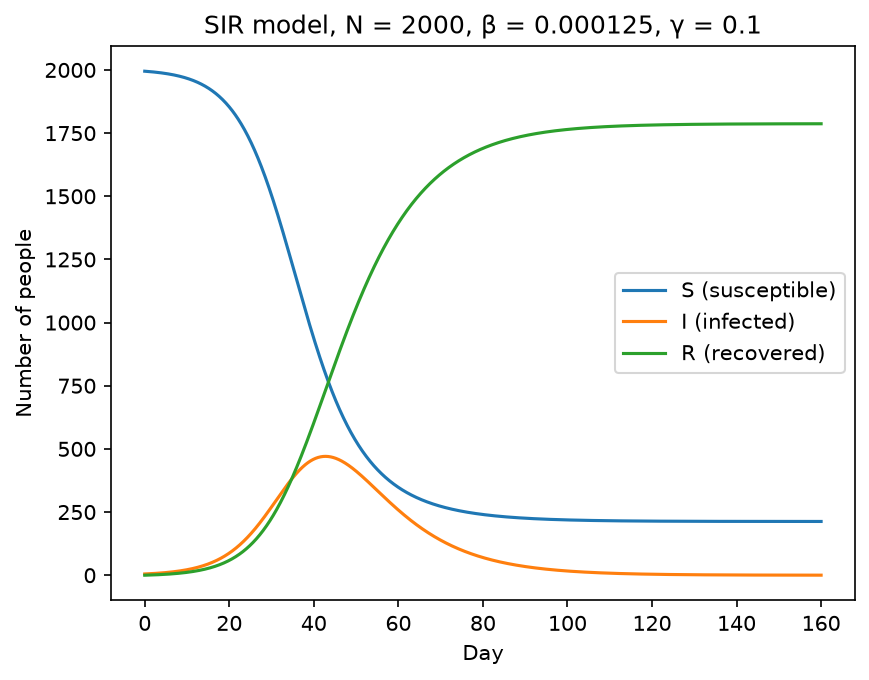
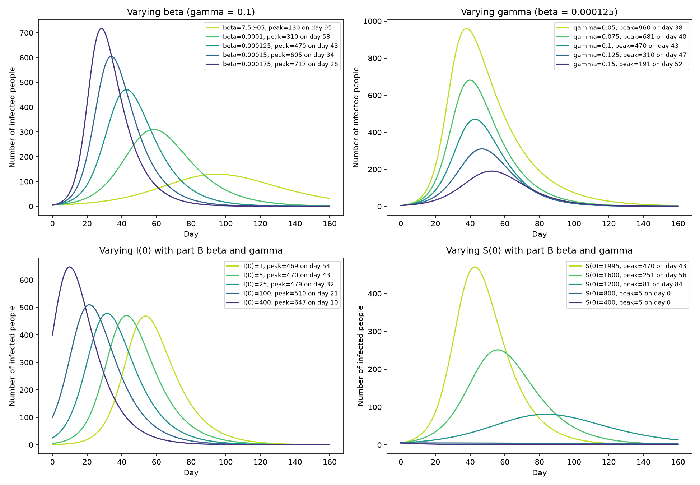
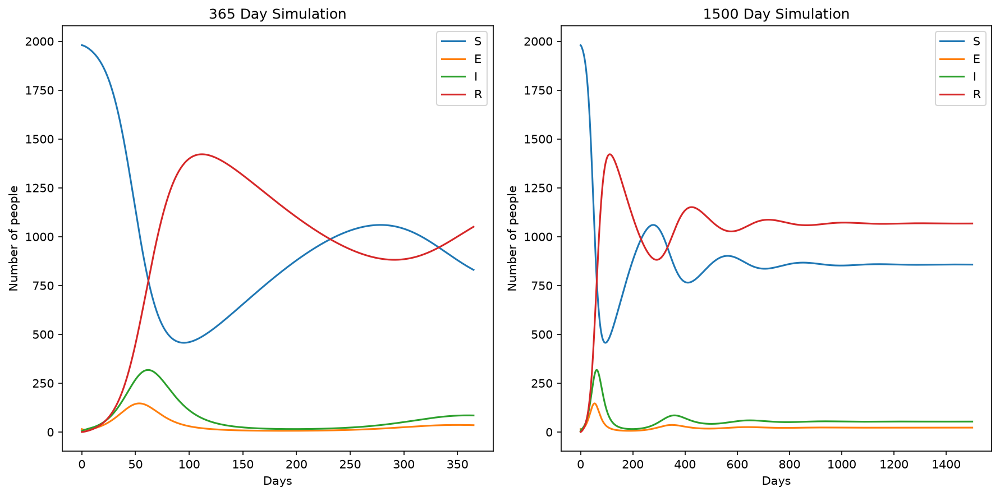
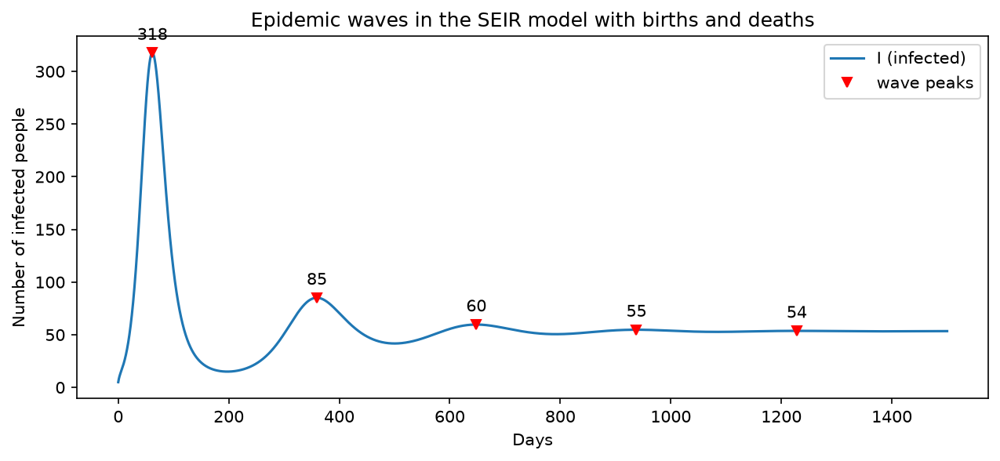
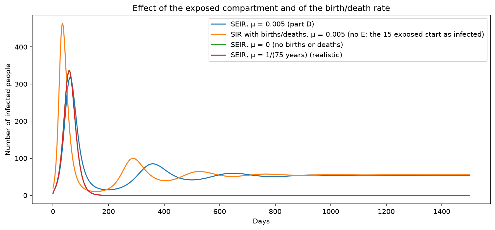
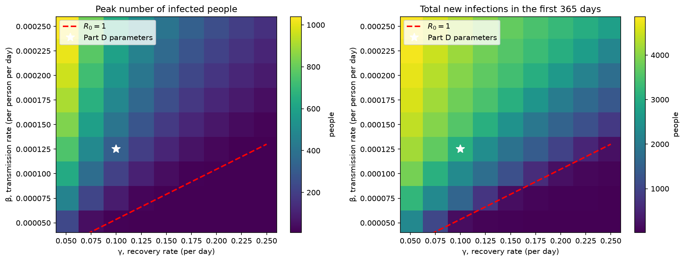
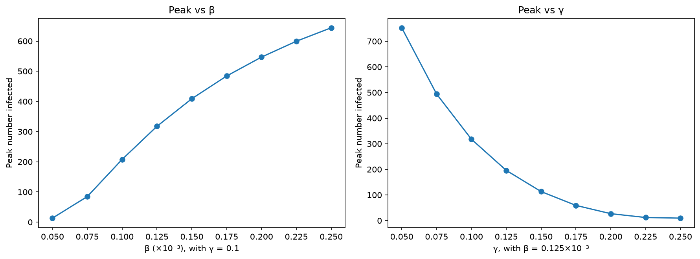

# BMI 500 Week 7 Homework: SIR and SEIR Model Implementation for Pandemic Spread (HW1)

Matthew Runyan, matthew.runyan@emory.edu
Question: HW1

## Deliverables

- `hypothesis.pdf`: handwritten hypothesis page
- `hw1_part_a.ipynb` to `hw1_part_e.ipynb`: one notebook per part
- `slide.pdf`: single summary slide
- figures are saved as `.png` files by the notebooks and shown below

## How to run

Python 3. From this folder:

```bash
pip install -r requirements.txt
jupyter notebook # or however you use jupyter
```

Then run the notebooks in order, part a through part e. Each notebook is self contained (the solver from part A is copied into the later notebooks). All simulations use forward Euler with a step of 0.1 day.

## Part A: SIR model implementation

Implemented in `hw1_part_a.ipynb`. The forward Euler solver is the function `forwardEuler`, which takes the derivative function, the initial values and the array of time points, and returns the values at every time point by adding the time step times the derivative at the previous step. The SIR equations are in `sir_ders`, and `sir_model` runs them through the solver.

## Part B: SIR simulation

Implemented in `hw1_part_b.ipynb` using `sir_model` from part A.

N = 2000, S(0) = 1995, I(0) = 5, R(0) = 0, beta = 0.000125, gamma = 0.1, 160 days.



## Part C: Analysis and interpretation

Implemented in `hw1_part_c.ipynb` using `sir_model` from part A.

**i. Infection peak.** The maximum infected population is about 470, which occurs on day 43. At the peak the susceptible population is 800, which is gamma/beta, because I stops growing when the new infections per day beta\*S\*I equal the recoveries per day gamma\*I, and dividing out I gives S = gamma/beta = 0.1/0.000125 = 800. So the peak is determined by how far S has to fall to reach gamma/beta and how fast it gets there. A larger beta means faster spread, so the peak comes earlier and is higher since S has to fall further before infections and recoveries balance and fewer people have had time to recover by then. A larger gamma drains the infected pool faster, so the peak is lower and comes later, and if gamma/beta is above S(0) there is no epidemic at all. The initial conditions also matter, as the 2x2 plot shows. More initial infected mostly makes the peak come earlier, and fewer initial susceptible makes the peak lower, down to no peak at all once S(0) is at or below 800.



**ii. Basic reproduction number.** R0 = beta\*N/gamma = 0.000125\*2000/0.1 = 2.5, which is the average number of people one infected person infects when everyone is susceptible. It comes from each infected person infecting about beta\*N people per day for an average of 1/gamma days. R0 = 1 is the dividing line, where an infected person on average infects one other person, so an R0 less than 1 means the epidemic is in decline and an R0 greater than 1 means it grows exponentially at first, and the larger R0 is the sooner and higher the peak since there is less time for the infected population to recover before it. Here R0 = 2.5 so each case leads to 2.5 new cases early on, which is why the epidemic takes off. To control the epidemic R0 has to be pushed below 1, either by lowering beta with social distancing, masks or quarantine, or by raising gamma with treatment that shortens the infectious period.

**iii. Epidemic dynamics.** At day 0, R(0) is 0 since we detect an epidemic when people become sick and nobody has recovered yet, and I(0) is small. Early on S barely changes while I grows exponentially at about beta\*S(0) - gamma = 0.15 per day, and R grows behind I with a lag of about 1/gamma = 10 days. As I grows S drops faster and faster since the infection rate beta\*S\*I depends on both. I peaks at about 470 on day 43 when S has fallen to gamma/beta = 800, which is where new infections per day equal recoveries per day. After this the infection rate is less than the recovery rate because there are fewer people left to infect regardless of the transmission rate, so I decreases while R keeps increasing as the infected pool drains into it. By the end about 213 people (11% of N) are still susceptible and were never infected, and about 1787 were infected at some point. Not everyone gets infected because the epidemic ends when S falls too low for each case to replace itself, not when S reaches 0, so once I is near 0 the remaining susceptible people are safe even though they are not immune.

## Part D: SEIR model with births and deaths

Implemented in `hw1_part_d.ipynb` in the functions `seir_ders` and `seir_model`, using the same `forwardEuler` solver as part A. `report_waves` finds the peaks and troughs of I. `sir_bd_ders` is the SIR model with births and deaths used in the part v comparison.

N = 2000, S(0) = 1980, E(0) = 15, I(0) = 5, R(0) = 0, beta = 0.000125, gamma = 0.1, sigma = 0.25, mu = 0.005.





**iii. Epidemic waves.** In the first 365 days there are two waves, the first peaking at about 318 infected on day 62 and the second at about 85 on day 359, with a trough of about 15 infected around day 198 in between. Over 1500 days there are five waves on days 62, 359, 648, 938 and 1228 with peaks of 318, 85, 60, 55 and 54 infected, about 290 days apart, with each wave smaller than the last and the troughs rising (15, 42, 51, 53, 53) until I settles at about 53 infected. The waves are caused by births adding mu\*N = 10 new susceptible people per day. After the first wave burns through S, I falls since each infected person infects fewer than one other, but births slowly refill S until it is back above N/R0 and each case more than replaces itself, which starts the next wave. The waves shrink because S never gets back to its starting value, the second wave starts from about 850 susceptible instead of 1980, and eventually births and infections balance out at a steady level, which is why the waves attenuate toward about 53 infected rather than to 0.

**iv. R0 and N/R0.** R0 = beta\*N\*sigma/((sigma+mu)\*(gamma+mu)) = 2.33, compared to 2.5 in part C. It is lower because deaths now remove people from the chain of infection. An exposed person can die before becoming infectious (sigma/(sigma+mu) = 0.98 survive the latent period) and an infectious person leaves by recovery or death so the average infectious period is 1/(gamma+mu) = 9.5 days instead of 10 (a factor of gamma/(gamma+mu) = 0.952), and 2.5\*0.98\*0.952 = 2.33. N/R0 = 857 and the simulated S at day 1500 is 857, so the long term susceptible population is N/R0. This is the number of susceptible people at which each infected person infects exactly one other person, so I neither grows nor shrinks, the same idea as S = gamma/beta = 800 at the peak in part C. Births push S up toward it when S is below it and infections pull S down when S is above it, so the population settles there.



**v. Exposed compartment and birth/death rate.** The exposed compartment adds a 1/sigma = 4 day delay between being infected and being infectious. Without it (SIR with births and deaths) the first wave peaks on day 34 with about 463 infected instead of day 62 with about 318, so the exposed compartment delays the first peak by about four weeks and lowers it by about 30%, because people in E are not transmitting yet, which slows the spread and gives more people time to recover before the peak. The birth and death rate is what allows the repeated waves. With mu = 0 the model behaves like part C, one wave peaking at about 336 on day 58 and then the disease dies out with S stuck at about 211. mu = 0.005 is a 200 day lifespan, chosen so the waves fit in a short simulation. With a realistic 75 year lifespan (mu about 0.00004 per day, about 0.07 births per day instead of 10) R0 goes back to 2.5, the first wave looks the same as mu = 0, and no second wave shows up in 1500 days since it would take decades for births to bring S back up to N/R0, and by then I is essentially 0 so the disease would have to be reintroduced from outside.

## Part E: Sensitivity analysis

Implemented in `hw1_part_e.ipynb` using `seir_model` from part D in a loop over the beta and gamma grid.

9 values of beta (0.00005 to 0.00025) by 9 values of gamma (0.05 to 0.25), SEIR model of part D for 365 days each. Total new infections is the flow out of S, beta\*S\*I, summed over the year.





**ii. Results.** Both heatmaps have the same shape. The peak and the total number of infections are largest at high beta and low gamma (top left, R0 up to 8.9) and fall off toward low beta and high gamma. The dashed line is R0 = 1, which for this model is beta = (sigma+mu)\*(gamma+mu)/(N\*sigma). Below it R0 is less than 1 (16 of the 81 pairs) and there is no epidemic, the peak is only 8 to 13 people, which is just the 20 people who start out exposed or infected plus a short chain of cases that dies out, and the total new infections over the year is between 12 and about 220, with the larger totals in the cells just under the line where R0 is 0.93 to 0.96 and each case almost replaces itself. The peak and the total rise steeply across the line, for example along the part D row one grid step in beta takes R0 from 0.93 to 1.40 and the total from 172 to 1568, so R0 = 1 is the threshold for whether an outbreak takes off and it depends on beta and gamma together. For the part D pair (beta = 0.000125, gamma = 0.1, white star) R0 = 2.33 with a peak of 318 and 3075 new infections in the year. Both parameters vary by a factor of 5 on the grid, and along the part D row and column the peak goes from 13 to 644 as beta increases but from 9 to 753 as gamma decreases, so gamma actually has a slightly larger effect on the peak, contrary to my hypothesis. This is because gamma affects the peak in two ways, through R0 like beta does but also through how long each person stays infectious (1/gamma days), so a lower gamma piles more people up in I at the same time. I checked this by holding R0 at 3 and changing gamma: with gamma = 0.05, 0.1 and 0.2 the peak is 536, 443 and 338 while the total stays at about 3500 to 3700. For the total number of infections the two are about equal (172 to 4287 along beta, 217 to 4196 along gamma) since the total depends mainly on R0.

**iii. Public health implications.** beta depends on how often susceptible and infected people come into contact, so social distancing, lockdowns and masks lower beta. gamma is one over the infectious period, so treatment that clears the infection faster raises gamma, and isolating people once they test positive does the same thing since it removes them from the infectious pool sooner. The heatmaps show two things an intervention can do. One is to end the epidemic by pushing R0 below 1, which from the part D pair means cutting beta to about 0.000054 (a 57% reduction in transmission) or raising gamma to about 0.24 (an infectious period of about 4 days instead of 10), or some combination along the red line. The other is to flatten the curve even if R0 stays above 1, for example raising gamma from 0.1 to 0.15 cuts the peak from 318 to 113 and the yearly total from 3075 to 1839, and the peak is what decides whether hospitals are overwhelmed. Since gamma affects the peak slightly more, treatment and fast isolation are at least as useful as distancing for keeping the peak down, while both reduce the total number infected about equally. A limitation is that beta and gamma are held constant for a whole year, when in reality interventions and behavior change over time.

## Hypothesis revisited

My hypothesis was partly supported.

1. **Peak in part B.** I hypothesized that the maximum infected peak would be  around day 40 with roughly 600 to 700 infected, becasue i reasoned that the peak happens when S falls to gamma/beta = 800 and guessed at the fraction of the 1195 people  that would ahve recovered at this time. The simulation gives day 43 with 470 infected. The day and the S = 800 condition were right, but I underestimated how many had already recovered: it was 730 of 1195, about 61%, not a third to a half, so the peak was lower than I predicted.

2. **Waves in part D.** I predicted several waves that shrink over time, driven by births refilling the susceptible pool, with the exposed compartment delaying and flattening the first peak which was correct. What I did not predict is that the waves settle at a steady nonzero level (53 infected) rather than dying out, which makes sense.
3. **beta vs gamma in part E.** I said that beta would have the larger effect on the peak. This turned out to not be correct. Over the same factor of 5 range, gamma changed the peak slightly more (9 to 753) than beta did (13 to 644). My reasoning missed that gamma affects the peak twice, through R0 and through how long each infected person stays in I, while beta only enters through R0.

## AI statement

Statement: Claude Fable 5.1 (Anthropic, through the Claude Code extension in VS Code) was used to aid in completion of this homework. The full chat is available at: https://github.com/mrunyan1/BMI500_week7_hw/ai_chat_log.txt

Claude Code does not generate a shareable chat link, so the complete transcript of the session is exported unedited to `ai_chat_log.md` in this repository (linked above) as the last step before the final commit. It was used for: eviewing my typed hypothesis draft and rewriting parts of it before I wrote the page by hand; reviewing my forward Euler and SIR code in part A and suggesting fixes (returning an array, the 0.1 day step size, the solve_ivp verification); writing the 2x2 comparison plot in part C; fixing S(0) and the step size in my part D code and adding the wave reporting and comparison runs; heatmap and comparison code; and setting up the virtual environment, requirements.txt and this README. The are completly hypothesis page and the slide are my own.
